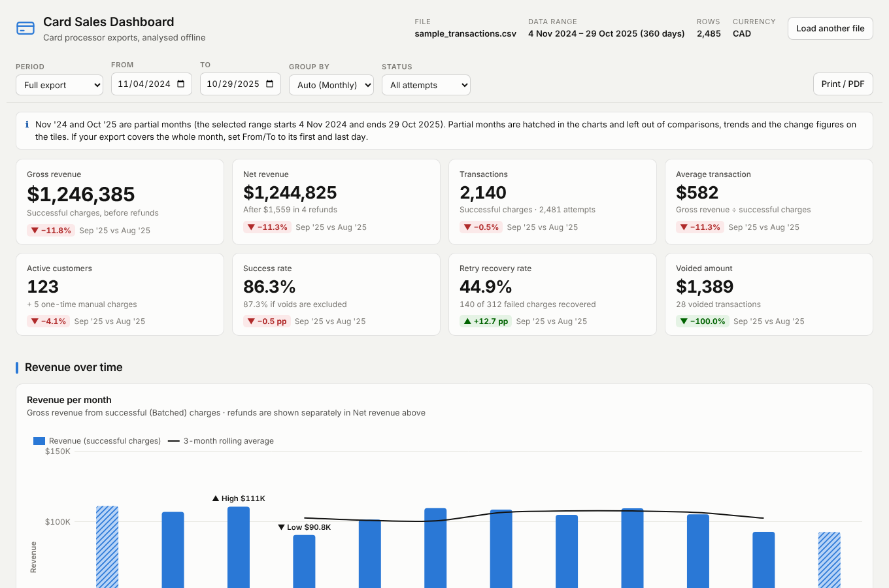
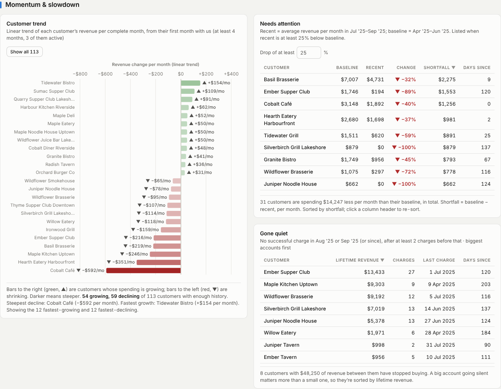
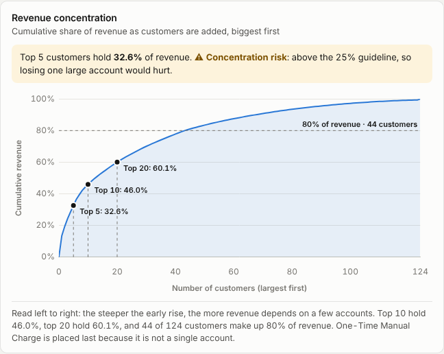
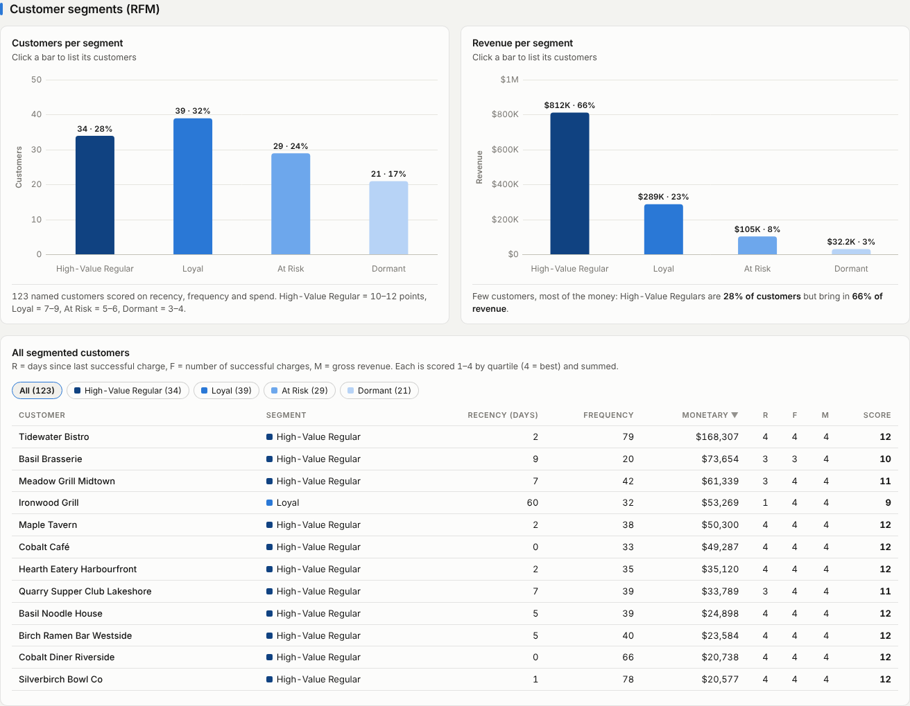
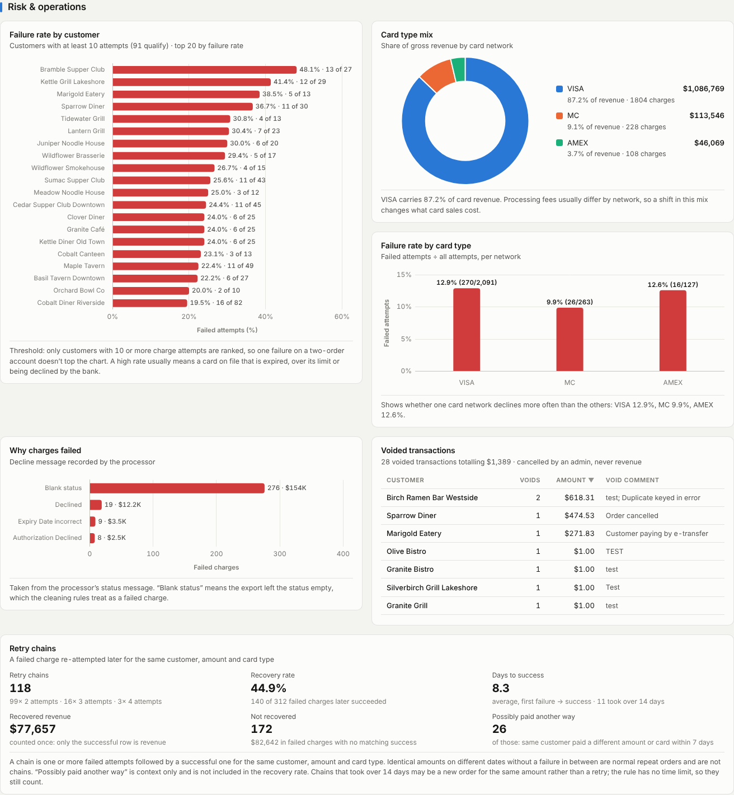
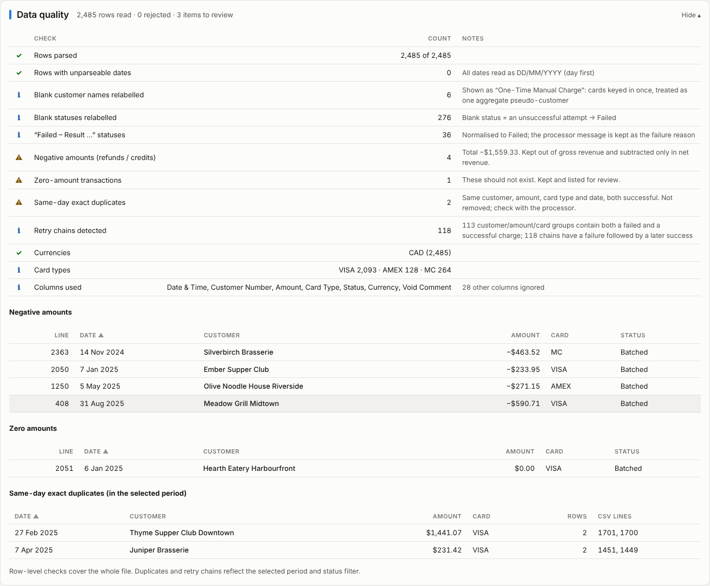
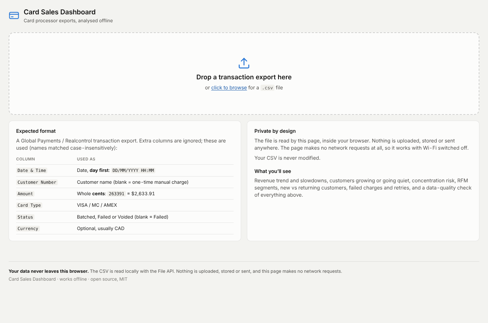
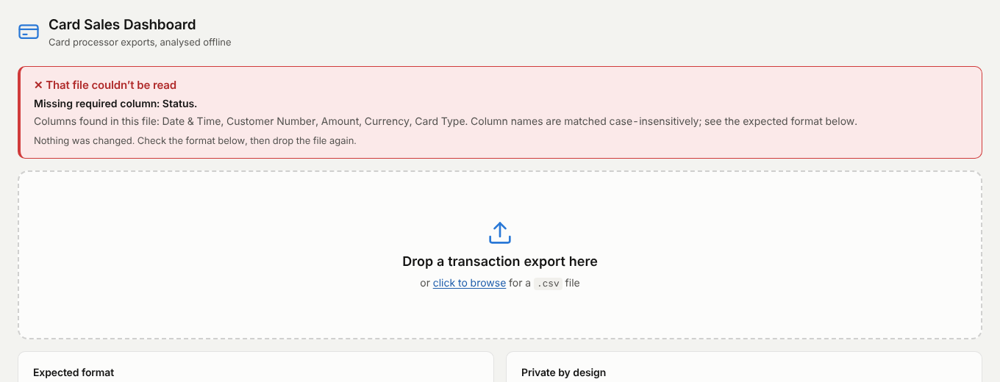
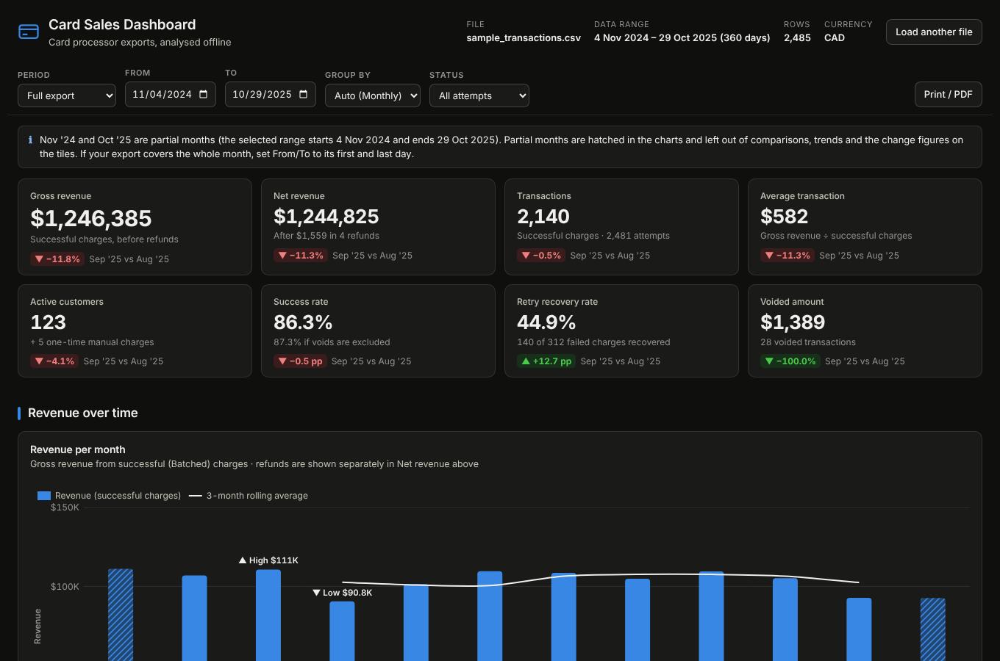

# Card Sales Dashboard

An **offline, single-file dashboard** for credit card transaction exports. Open
`dashboard.html` by double-clicking it, drop in a CSV from the card processor, and
see how card sales are trending: how much is being charged, which customers drive
it, who is growing, who is slowing down, and where charges are failing.

No Python, no server, no internet connection, no install. **Your data never leaves
your browser.**



> Every screenshot in this repository uses **synthetic data with made-up customer
> names** (`sample-data/sample_transactions.csv`). No real transactions are stored here.

## Why it exists

I'm an account manager at a fresh-produce distributor. Our customers pay by card on
file, and the processor's export is the best early-warning signal we have: a
customer whose orders shrink, whose card keeps declining, or who stops ordering
shows up there weeks before it shows up anywhere else. The analysis used to live in
a Jupyter notebook that had to be re-run by hand. This replaces it with one HTML
file that anyone on the team can open.

## Using it

1. Download [`dashboard.html`](dashboard.html) (in GitHub, use **Download raw file**).
2. Open it in Chrome, Edge, Firefox or Safari. It works straight from your
   downloads folder (`file://`) with Wi-Fi switched off.
3. Drag a transaction export onto the page, or click to browse.
4. Use the filter bar to narrow the date range, change the grouping
   (day / week / month / quarter), or show successful charges only.
5. **Print / PDF** produces a clean, light-themed report to send to someone else.

To try it without real data, load [`sample-data/sample_transactions.csv`](sample-data/sample_transactions.csv).

## Privacy

This tool handles real financial data for real customers, so privacy is built in,
not bolted on:

- **The CSV is read locally with the browser's File API.** Nothing is uploaded,
  stored or sent anywhere. The footer of the dashboard says so too.
- **The page cannot reach the network.** It ships with a Content-Security-Policy of
  `default-src 'none'; connect-src 'none'; …`, so even an accidental `fetch()` would
  be blocked by the browser. There are no CDN links, web fonts or analytics; Chart.js
  and all CSS/JS are inlined.
- **The source file is never modified.** It is only ever read.
- **No real data in the repo.** `.gitignore` ignores every `*.csv`, `*.xlsx` and any
  `data/` folder, with explicit exceptions only for the synthetic sample and test
  fixtures. The tests that check a real export write their results to a temporary
  folder outside the repo.

## Input format

A Global Payments / Realcontrol-style export has about 35 columns; six are used.
Columns are matched case-insensitively, in any order, and missing optional columns
are tolerated. If a required column is missing, the dashboard says which one.

| Source column | Becomes | Notes |
|---|---|---|
| `Date & Time` | date | `DD/MM/YYYY HH:MM`, **day first**. Parsed explicitly, never with `Date.parse()`. |
| `Customer Number` | customer name | Despite the name, it holds the customer name. |
| `Amount` | amount | **Integer cents**, divided by 100. |
| `Currency` | currency | Usually CAD. Optional. |
| `Card Type` | card type | VISA / MC / AMEX. |
| `Status` | status | Batched (successful), Failed, Voided. |

The full contract (aliases, encodings, edge cases) is in
[docs/csv-format.md](docs/csv-format.md).

### Cleaning rules

- **Day-first dates.** `03/11/2025` is 3 November. Unreadable dates are rejected and
  listed with their line numbers.
- **Cents.** Amounts are divided by 100; internally everything stays in integer cents
  so the totals are exact.
- **Blank status = Failed.** An unsuccessful attempt is exported with an empty status.
  Statuses like `Failed - Result [101] Message [Declined]` are also Failed, and the
  message is kept as the failure reason.
- **Blank customer = One-Time Manual Charge.** These are cards keyed in once. They
  are treated as one pseudo-customer, marked † "aggregate" wherever they could rank,
  and left out of per-customer trend analysis.
- **Negative amounts** (refunds, chargebacks) are never netted silently. Gross and net
  revenue are both shown, and the refunds are listed in the data-quality panel.
- **Zero amounts** are flagged, not dropped.
- **Revenue counts `Batched` charges only**, except in the sections about failures
  and voids.
- **Retry chains.** For each customer + amount + card type, one or more failures
  followed by a later success make a chain. Only the successful row counts as
  revenue. Identical amounts on different dates are treated as normal repeat orders
  (customers order from a fixed order guide); only same-day, same-amount, both-successful
  rows are flagged as possible duplicates, and they are never removed automatically.

## What's on the dashboard

**Header and filters.** File name, data range, row count, currency; a date-range
filter with presets; grouping (auto-picked from the data's span); status filter.

| Data span | Default grouping |
|---|---|
| ≤ 60 days | Daily |
| 61 days – 6 months | Weekly |
| 6 months – 5 years | Monthly |
| 5 years or more | Quarterly |

**KPI tiles.** Gross and net revenue, transactions, average transaction, active
customers, success rate, retry recovery rate and voided amount. Each tile shows
the change from the last complete period to the one before, with an arrow, a sign
and a colour.

**Revenue over time.** Revenue per period with a rolling average (3-month, 4-week,
7-day or 4-quarter) and the highest and lowest periods annotated. Below it, a
diverging chart of period-over-period % change, which makes a *slowdown* visible
and not just a level.

**Momentum and slowdown.** A linear trend ($ per period) for every customer with
enough history, drawn as a diverging bar chart (deeper red = steeper decline). Next
to it: a **Needs attention** table (recent 3 periods at least *X*% below the 3 before,
with an adjustable threshold) and a **Gone quiet** list sorted by lifetime revenue.



**Customers.** Top 15 by revenue, a Pareto concentration curve with a plain-English
risk call-out when the top 5 hold more than 25%, average revenue per *active* month,
payment cadence (usual gap vs days since the last charge), and a list of customers
who are overdue against their own rhythm.



**Segments (RFM).** Recency, frequency and monetary value, each scored 1–4 by
quartile (with `rank(method='first')` tie-breaking) and summed: High-Value Regular
(10–12), Loyal (7–9), At Risk (5–6), Dormant (3–4). Click a segment to list its
customers.



**Acquisition.** New vs returning customers per period, with a cumulative line of
unique customers, which shows whether the base is growing or just churning sideways.

**Risk and operations.** Failure rate by customer (10+ attempts only, stated on
screen), card type mix, failure rate by card network, decline reasons, retry chains
(attempt counts, days to recover, recovery rate) and voided transactions.



**Data quality.** Collapsed by default. Shows rows parsed, rejected rows with line
numbers, relabelled blanks, negative and zero amounts, same-day duplicates, retry
chains, currencies and the columns used. This panel is what makes the numbers above
it trustworthy.



Every chart has a title, axis labels and a one-line caption in plain English. Colour
is never the only signal: growth and decline also carry ▲ / ▼ and a sign, partial
periods are hatched and starred, and the one-time aggregate is tagged. Light and dark
mode follow the operating system.

| Empty state | Error state | Dark mode |
|---|---|---|
|  |  |  |

## Judgement calls

The brief left these open, or real data didn't match an assumption. Each is noted
here so it isn't hidden in the code.

**Data and cleaning**
- **Failed statuses carry a reason.** Real exports write
  `Failed - Result [101] Message [Declined]` rather than a blank, so any status
  *starting with* "Failed" counts as Failed and the message is kept as the reason.
  Blank still means Failed.
- **`Void Comment` is read if present** and shown next to voided transactions.
  The brief said to drop other columns, but the comment explains most voids
  (often `$1.00` card-on-file tests).
- **Currency is optional.** Mixed currencies raise a warning; amounts are not
  converted.
- **Amounts with decimals are rejected**, because the contract is whole cents. A
  file exported in dollars fails with a clear message rather than being silently
  divided by 100.

**Periods**
- **Partial periods.** A period is partial when the selected range doesn't cover
  all of it, for example an export that starts on 6 January. Partial periods are
  hatched and starred in charts, and left out of period-over-period changes,
  rolling averages, KPI deltas and the momentum analysis. Otherwise a 28-day
  November would look like a slowdown. If an export really covers the whole first
  or last month, set *From/To* to the month boundaries and that month counts as
  complete.
- **The 5-year boundary.** The brief's table puts "2–5 years" under monthly and
  "> 5 years" under quarterly, but also expects a 5-year file to be quarterly. A
  span of **1,826 days or more** (five full calendar years) is quarterly.
- **Rolling windows** are 3 months, 4 weeks, 7 days or 4 quarters. The brief
  specified the first two.
- **"Days since last charge"** is measured to the end of the selected range, not
  to today, so an old export reads the same whenever it is opened.

**Metrics**
- **Success rate** = successful ÷ all charge attempts (Batched + Failed + Voided,
  refunds excluded), as specified. Voids are mostly admin test charges, so the tile
  also shows the rate without them.
- **Transactions** counts successful charges; the number of attempts is shown
  underneath.
- **Active customers** counts named customers. One-time manual charges are shown
  separately so the aggregate isn't counted as one customer.
- **The One-Time Manual Charge aggregate** is included in revenue totals, the
  top-15 list, the per-active-month chart and failure/void lists, always tagged †.
  It is placed last on the Pareto curve and never counts towards top-5
  concentration. It is excluded from trends, needs attention, gone quiet,
  cadence, RFM and acquisition.
- **Retry chains are sequential.** The brief defines a chain as a group holding
  ≥1 Failed and ≥1 Batched. Here, only failures *followed by* a later success
  count as recovered, because a success that came before a failure isn't a
  recovery. A group can hold several chains. Both counts are shown in the
  data-quality panel.
- **No time window on retries.** As specified, a failure and a same-amount success
  weeks later still form a chain. Chains that took more than 14 days are counted
  on screen, since with fixed order guides they may be a new order.
- **"Possibly paid another way"** is a context-only figure: unrecovered failures
  where the same customer paid a *different* amount or card within 7 days. It is
  not part of the recovery rate.
- **Momentum** uses complete periods from each customer's first period, needing at
  least 4 periods with 3 active, so a customer who joined in month 9 isn't fitted
  with eight leading zeros. *Needs attention* is sorted by dollar shortfall (an
  extra column) and needs 6 complete periods. *Gone quiet* requires at least 2
  successful charges before the silence, so one-off buyers aren't listed.
- **Average revenue per active period** divides by periods with at least one
  successful charge.
- **Payment cadence** uses distinct charge days and needs 3 or more. A customer is
  overdue when the days since their last charge are at least twice their usual
  gap and at least 7 days. The axis is capped at 3× the largest usual gap; markers
  off the scale show as ▶.
- **RFM** covers named customers only, breaks ties alphabetically, and needs at
  least 4 customers.
- **Acquisition** counts "new" relative to the start of the export, so everyone in
  the first period is new. The caption says so.
- **Customer rankings and card mix** use gross revenue.
- **The status filter.** Revenue is always Batched-only, so *Successful only*
  mostly serves as a clean view for printing: failure, retry and void sections are
  hidden, with a note explaining why.
- **Printing** snapshots each chart as an image, so charts scale to any paper size,
  and caps long tables at 15 rows with a note.

## Rebuilding from source

The distributable is one file, but the source is modular:

```
cc-sales-dashboard/
├── dashboard.html              ← built, self-contained deliverable (~350 KB)
├── build.py                    ← inlines src/ + vendor/ into dashboard.html
├── src/
│   ├── index.html              ← page structure (open directly while developing)
│   ├── styles.css              ← all colours are CSS custom properties on :root
│   ├── parse.js                ← CSV reading + cleaning rules (pure functions)
│   ├── metrics.js              ← all calculations (pure functions, integer cents)
│   ├── charts.js               ← formatting + Chart.js construction
│   └── app.js                  ← wiring, filters, state, rendering
├── vendor/chart.umd.min.js     ← Chart.js 4.4.7 (MIT), committed, never from a CDN
├── sample-data/                ← synthetic export, fake names
├── scripts/
│   ├── generate_sample.py      ← deterministic synthetic data + edge-case fixtures
│   └── screenshots.mjs         ← regenerates docs/screenshots from the sample
├── tests/
│   ├── run_all.sh              ← the whole verification suite
│   ├── unit.test.mjs           ← parser + metric unit tests (node --test)
│   ├── e2e.mjs                 ← headless-browser test of the built file
│   ├── verify_metrics.py       ← independent pandas re-computation
│   └── fixtures/               ← 90-day, 5-year, one-customer, malformed… files
└── docs/csv-format.md          ← input contract + cleaning rules
```

```bash
python3 build.py              # rebuild dashboard.html (deterministic)
python3 build.py --check      # fail if dashboard.html is stale
tests/run_all.sh              # full verification on synthetic data
tests/run_all.sh export.csv   # …and on a real export (results kept outside the repo)
```

Requirements for building and testing only: Python 3.10+ with pandas and numpy,
and Node 18+ with Playwright/Chromium. The dashboard itself needs nothing but a
browser. The JavaScript is vanilla, with no framework and no npm runtime
dependency.

## How it was verified

`tests/run_all.sh` runs these checks, and they all pass:

1. **Unit tests** for the tokenizer (quotes, commas, `\r\n`, BOM, newlines in
   fields), day-first dates, cents, status normalisation, column detection,
   bucket boundaries, retry-chain sequencing and quartile scoring against pandas
   output.
2. **The built file in headless Chromium**, loaded from `file://` in an *offline*
   browser context. The test fails on any network request or console error, loads
   the CSV through the real file input, checks that all 8 tiles and every chart
   rendered (or show a designed empty state), clicks every control and prints a
   PDF.
3. **Independent maths.** `verify_metrics.py` recomputes the figures in pandas and
   asserts they match the rendered dashboard: gross, net and refunds to the cent,
   transaction and attempt counts, success rates, top-5/top-10 concentration,
   retry chains and recovery rate, revenue per bucket, **every customer's trend
   slope**, RFM segment sizes, and the text shown on the tiles. 29/29 checks pass
   on the sample, and on a real export.
4. **Edge cases.** A 90-day file buckets weekly, a 5-year file quarterly, a
   one-customer file renders (with explanatory empty states where a chart needs
   more customers), and a missing column, an unterminated quote, ISO dates and a
   binary file each fail with a readable message.
5. **Offline.** The build fails if any `src`, `href`, `fetch`, `url()` or
   `@import` points off the page, and the CSP blocks requests at runtime.
6. **Size.** 100,000 rows (21 MB) parse and analyse in about 2 seconds.

## Licence

MIT. Chart.js is © Chart.js Contributors, MIT (see `vendor/chart.js-LICENSE.md`).
