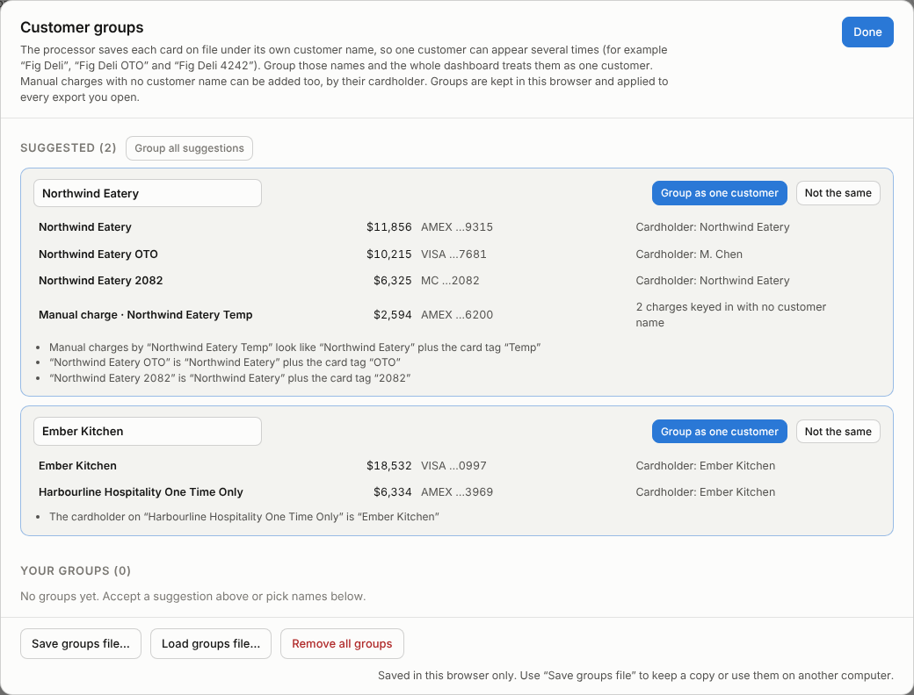

# Card Sales Dashboard

An **offline, single-file dashboard** for credit card transaction exports. Open
`dashboard.html` by double-clicking it, drop in a CSV from the card processor, and
see how card sales are trending: how much is being charged, which customers drive
it, who is growing, who is slowing down, and where charges are failing.

No Python, no server, no internet connection, no install. **Your data never leaves
your browser.**


> Every screenshot in this repository uses **synthetic data with made-up customer
> names** (`sample-data/sample_transactions.csv`). No real transactions are stored here.

## Why it exists

I'm an account manager at a fresh-produce distributor. Our customers pay by card on
file, and the processor's export is the best early-warning signal we have: a
customer whose orders shrink, whose card keeps declining, or who stops ordering
shows up there weeks before it shows up anywhere else. The analysis used to live in
a Jupyter notebook that had to be re-run by hand. This replaces it with one HTML
file that anyone on the team can open.

## Using it

1. Download [`dashboard.html`](dashboard.html) (in GitHub, use **Download raw file**).
2. Open it in a desktop browser (Chrome, Edge, Firefox or Safari). It works
   straight from your downloads folder (`file://`) with Wi-Fi switched off.
3. Drag a transaction export onto the page, or click to browse.
4. Use the filter bar to narrow the date range, change the grouping
   (day / week / month / quarter), or show successful charges only.
5. **Print / PDF** produces a clean, light-themed report to send to someone else.

To try it without real data, load [`sample-data/sample_transactions.csv`](sample-data/sample_transactions.csv).

## Privacy

This tool handles real financial data for real customers, so privacy is built in,
not bolted on:

- **The CSV is read locally with the browser's File API.** Nothing is uploaded,
  stored or sent anywhere. The footer of the dashboard says so too.
- **The page cannot reach the network.** It ships with a Content-Security-Policy of
  `default-src 'none'; connect-src 'none'; …`, so even an accidental `fetch()` would
  be blocked by the browser. There are no CDN links, web fonts or analytics; Chart.js
  and all CSS/JS are inlined.
- **The source file is never modified.** It is only ever read.
- **No real data in the repo.** `.gitignore` ignores every `*.csv`, `*.xlsx` and any
  `data/` folder, with explicit exceptions only for the synthetic sample and test
  fixtures. The tests that check a real export write their results to a temporary
  folder outside the repo.
- **Customer groups stay on your computer.** They are your customers' names, so they
  are never part of this code. They are saved in the browser's local storage, and
  optionally in a `customer-groups.csv` you export yourself (also covered by
  `.gitignore`).

## Input format

A Global Payments / Realcontrol-style export has 35 to 117 columns, depending on its age; six are used.
Columns are matched case-insensitively, in any order, and missing optional columns
are tolerated. If a required column is missing, the dashboard says which one.

| Source column | Becomes | Notes |
|---|---|---|
| `Date & Time` | date | `DD/MM/YYYY HH:MM` (**day first**) or `YYYY-MM-DD HH:MM:SS`. Parsed explicitly, never with `Date.parse()`. |
| `Customer Number` | customer name | Despite the name, it holds the customer name. |
| `Amount` | amount | **Integer cents**, divided by 100. |
| `Currency` | currency | Usually CAD. Optional. |
| `Card Type` | card type | VISA / MC / AMEX. |
| `Status` | status | Batched (successful), Failed, Voided. |
| `Cardholder's Name` | – | Optional. Only used to suggest customer groups. |
| `Card Number` | – | Optional, already masked by the processor. Only the last 4 digits are read, to suggest customer groups. |

The full contract (aliases, encodings, edge cases) is in
[docs/csv-format.md](docs/csv-format.md).

### Cleaning rules

- **Explicit dates.** Slash dates are always day first (`03/11/2025` is 3 November);
  year-first dates (`2026-06-30 21:44:36`) are read as written. Month-first US dates
  and anything else unreadable are rejected and listed with their line numbers.
- **Cents.** Amounts are divided by 100; internally everything stays in integer cents
  so the totals are exact.
- **Blank status = Failed.** An unsuccessful attempt is exported with an empty status.
  Statuses like `Failed - Result [101] Message [Declined]` are also Failed, and the
  message is kept as the failure reason.
- **Blank customer = One-Time Manual Charge.** These are cards keyed in once. They
  are treated as one pseudo-customer, marked † "aggregate" wherever they could rank,
  and left out of per-customer trend analysis.
- **Negative amounts** (refunds, chargebacks) are never netted silently. Gross and net
  revenue are both shown, and the refunds are listed in the data-quality panel.
- **Zero amounts** are flagged, not dropped.
- **Revenue counts `Batched` charges only**, except in the sections about failures
  and voids.
- **Retry chains.** For each customer + amount + card type, one or more failures
  followed by a later success make a chain. Only the successful row counts as
  revenue. Identical amounts on different dates are treated as normal repeat orders
  (customers order from a fixed order guide); only same-day, same-amount, both-successful
  rows are flagged as possible duplicates, and they are never removed automatically.

### Failed and voided transactions

| | Failed | Voided |
|---|---|---|
| **What it is** | A charge the bank declined. Exported with a blank status or as `Failed - Result [101] Message [Declined]` (or another message). | A charge an admin cancelled, often a `$1.00` card-on-file test with the comment "Test". |
| **Revenue, transactions, average, customer rankings, trends, RFM, cadence, acquisition** | Never counted | Never counted |
| **Success rate** | In the denominator: successful ÷ (successful + failed + voided). | In the denominator too, as the brief specified. The tile also shows the rate without voids. |
| **Failure rate** (by customer, 10+ attempts; by card type) | Counted as failures | Counted as attempts, not failures |
| **Decline reasons** | Grouped by the processor's message; a blank status shows as "Blank status" | – |
| **Retry chains** | A failure followed by a later success for the same customer, amount and card type is *recovered*. The success is the only row counted as revenue. | Ignored |
| **Own reporting** | Retry recovery rate tile, retry-chain panel (chains, attempts, days to recover, unrecovered amount) | Voided amount tile (an increase shows red), voided-transactions table with the void comment |
| **Status filter "Successful only"** | Hidden | Hidden |

Refunds (negative `Batched` amounts) are a third case. They are kept out of gross
revenue, subtracted only in net revenue, and listed in the data-quality panel.

### Customer groups

The processor saves each card on file under its own customer name, so one business
can appear as several customers. For example, a customer might appear under its own
name, as `<name> OTO` for a one-time-only card, as `<name> 4242` named after a card
ending, or as a parent company whose cardholder is the restaurant. Until those names
are grouped, every chart, ranking and trend splits the customer. A customer who
switches cards then looks like one account going quiet and a new one appearing.

**Customer groups** (in the filter bar) fixes this:

- **Suggestions from the export.** Two names are suggested as one customer when:
  - one is the other plus a card tag: `OTO`, `One Time Only`, `Temp`, `V2`, or **the
    last 4 digits of its own card**; or
  - the cardholder name on one is the other's customer name.

  Store numbers that aren't card endings (`Harbour Grill 7018`) and different locations
  (`Copper Bistro Midtown` / `Copper Bistro Lakeshore`) are never suggested. Neither is a
  card shared between names: chains often pay for several locations with one
  corporate card, and those locations are still separate customers.
- **Manual charges too.** A charge keyed in with no customer name normally joins the
  "One-Time Manual Charge" aggregate. If its cardholder identifies a customer (for
  example `Fig Deli Temp`), it can be assigned to that customer by cardholder name.
  Matching tags are suggested automatically; anything else can be picked by hand.
- **You confirm.** Nothing is merged until you click *Group as one customer*. You
  can rename the group, mark a suggestion *Not the same*, group any names by hand,
  or ungroup later.
- **Remembered.** Groups are saved in this browser and applied to every export you
  open, including next year's. *Save groups file* / *Load groups file* move them to
  another computer.
- **Visible.** Grouped customers carry a "3 names" tag in tables, chart tooltips list
  the names they combine, and the data-quality panel counts them.



## What's on the dashboard

**Header and filters.** File name, data range, row count, currency; a date-range
filter with presets; grouping (auto-picked from the data's span); status filter.

### Any length of export: 3 weeks, 3 months or 3 years

The dashboard reads the span of the export (or of the selected date range) and
picks a **timeframe**. The timeframe decides what every comparison means, so each
section gives the version of its answer that's meaningful for that much history.
Chart grouping is separate and only decides how the bars are drawn. A notice at
the top says, in one sentence, how the current export is being read.

| | **A few weeks** (≤ 45 days) | **A few months** (46–183 days) | **About a year** (184–395 days) | **More than a year** (396+ days) |
|---|---|---|---|---|
| Charts grouped by | day | day (≤ 60 days), then week | month | month (quarter from 5 years) |
| KPI tiles compare | last 7 days vs previous 7 | last 4 weeks vs previous 4 | last complete month vs the month before | last complete month vs **the same month a year earlier** |
| % change chart compares | each day with the same weekday a week before | each week with the week before | each month with the month before | each month with **the same month a year earlier** |
| Customers tracked by | 7-day blocks counted back from the last day | 7-day blocks | complete months | complete months; trends over the last 12 |
| Needs attention | last 2 weeks vs 2 before | last 4 weeks vs 4 before | last 3 months vs 3 before | last 3 months vs **the same 3 months a year earlier** |
| Gone quiet | nothing in the last 2 weeks | nothing in the last 2 weeks | nothing in the last 2 months | nothing in the last 2 months |
| New customers | not shown: too little history to tell | after a 35-day settling-in window | after a 45-day settling-in window | after a 45-day settling-in window |
| Extra | | | | **Year over year** chart and annual totals |

Why these choices:
- **Customers are tracked in whole weeks or months, never days.** In real exports
  about 75% of customers order at least every 2 weeks and about 95% at least every
  5 weeks, so a day-by-day comparison would flag regular customers on their normal
  off days.
- **Year-on-year comparisons cancel out seasonality.** A summer peak or a quiet
  January doesn't look like growth or a slowdown.
- **Gone quiet also needs the silence to be longer than twice the customer's own
  usual gap,** so a monthly customer isn't flagged after 2 weeks.
- **New customers need a settling-in window.** Every export starts part-way through
  existing relationships, so customers first seen in its opening weeks count as
  existing customers.

**KPI tiles.** Gross and net revenue, transactions, average transaction, active
customers, success rate, retry recovery rate and voided amount. Each tile shows
the change between the two windows the timeframe picks (above), with an arrow, a
sign and a colour. The gross tile also shows the average per week or per month.

**Revenue over time.** Revenue per period with a rolling average (3-month, 4-week,
7-day or 4-quarter) and the highest and lowest periods annotated. Below it, a
diverging chart of % change against a comparable earlier period, which makes a
*slowdown* visible and not just a level. Exports covering more than a year add a
**Year over year** chart, with one line per calendar year and annual and
year-to-date totals.

**Momentum and slowdown.** A linear trend ($ per week or month) for every customer
with enough history, drawn as a diverging bar chart (deeper red = steeper
decline). Next to it: a **Needs attention** table (recent spending at least *X*%
below a baseline, with an adjustable threshold) and a **Gone quiet** list sorted by
lifetime revenue.


**Customers.** Top 15 by revenue, a Pareto concentration curve with a plain-English
risk call-out when the top 5 hold more than 25%, average revenue per *active* month,
payment cadence (usual gap vs days since the last charge), and a list of customers
who are overdue against their own rhythm.


**Segments (RFM).** Recency, frequency and monetary value, each scored 1–4 by
quartile (with `rank(method='first')` tie-breaking) and summed: High-Value Regular
(10–12), Loyal (7–9), At Risk (5–6), Dormant (3–4). Click a segment to list its
customers.


**Acquisition.** New vs existing customers per period, with a cumulative line of
unique customers, which shows whether the base is growing or just churning sideways.

**Risk and operations.** Failure rate by customer (10+ attempts only, stated on
screen), card type mix, failure rate by card network, decline reasons, retry chains
(attempt counts, days to recover, recovery rate) and voided transactions.


**Data quality.** Collapsed by default. Shows rows parsed, rejected rows with line
numbers, relabelled blanks, negative and zero amounts, same-day duplicates, retry
chains, currencies and the columns used. This panel is what makes the numbers above
it trustworthy.


Every chart has a title, axis labels and a one-line caption in plain English. Colour
is never the only signal: growth and decline also carry ▲ / ▼ and a sign, partial
periods are hatched and starred, and the one-time aggregate is tagged. Light and dark
mode follow the operating system.

| Empty state | Error state | Dark mode |
|---|---|---|
|  |  |  |

## Judgement calls

The brief left these open, or real data didn't match an assumption. Each is noted
here so it isn't hidden in the code.

**Layout**
- **Desktop only.** The brief asked for a grid that collapses to one column under
  ~900px; after the first version this was changed to desktop browsers only. The
  layout keeps two columns at every width and has a 1,240px minimum (narrower
  windows scroll sideways). On wide monitors (1,700px+) the eight KPI tiles sit in
  one row and the charts get taller.

**Data and cleaning**
- **Customer identity.** The brief treats `Customer Number` as the customer. In real
  exports it's one label per card on file, so names are suggested for grouping and
  only merged once you confirm (see *Customer groups*). Grouping happens before every
  calculation. A failure on one of a customer's cards followed by a success on
  another card of the same type, for the same amount, now counts as a recovered
  retry. Manual charges (no customer name) stay in the one-time aggregate unless you
  assign them to a customer by their cardholder name.
- **Two date formats.** The brief specified `DD/MM/YYYY` (day first). Newer exports
  write `YYYY-MM-DD HH:MM:SS`, which is unambiguous because the year comes first,
  so both are accepted. Slash dates are still always day first; month-first dates
  are rejected, never swapped. Seconds, when present, order same-minute attempts,
  which matters because exports list the newest rows first.
- **Failed statuses carry a reason.** Real exports write
  `Failed - Result [101] Message [Declined]` rather than a blank, so any status
  *starting with* "Failed" counts as Failed and the message is kept as the reason.
  Blank still means Failed.
- **`Void Comment` is read if present** and shown next to voided transactions.
  The brief said to drop other columns, but the comment explains most voids
  (often `$1.00` card-on-file tests).
- **Currency is optional.** Mixed currencies raise a warning; amounts are not
  converted.
- **Amounts with decimals are rejected**, because the contract is whole cents. A
  file exported in dollars fails with a clear message rather than being silently
  divided by 100.

**Periods**
- **Timeframes.** The brief only adapted the chart grouping. Comparisons, customer
  tracking and "new customer" now adapt to the export's length as well (see *Any
  length of export*). The thresholds come from real ordering gaps.
- **Partial periods.** A period is partial when the selected range doesn't cover
  all of it, for example an export that starts on 6 January. Partial periods are
  hatched and starred in charts and skipped in the % change chart and rolling
  average. The tiles and customer tracking use complete 7-day blocks or complete
  months, so partial periods never affect them. Otherwise a 28-day November would
  look like a slowdown. If an export really covers the whole first or last month,
  set *From/To* to the month boundaries and that month counts as complete.
- **The 5-year boundary.** The brief's table puts "2–5 years" under monthly and
  "> 5 years" under quarterly, but also expects a 5-year file to be quarterly. A
  span of **1,826 days or more** (five full calendar years) is quarterly.
- **Rolling windows** are 3 months, 4 weeks, 7 days or 4 quarters. The brief
  specified the first two.
- **"Days since last charge"** is measured to the end of the selected range, not
  to today, so an old export reads the same whenever it is opened.

**Metrics**
- **Success rate** = successful ÷ all charge attempts (Batched + Failed + Voided,
  refunds excluded), as specified. Voids are mostly admin test charges, so the tile
  also shows the rate without them.
- **Transactions** counts successful charges; the number of attempts is shown
  underneath.
- **Active customers** counts named customers. One-time manual charges are shown
  separately so the aggregate isn't counted as one customer.
- **The One-Time Manual Charge aggregate** is included in revenue totals, the
  top-15 list, the per-active-month chart and failure/void lists, always tagged †.
  It is placed last on the Pareto curve and never counts towards top-5
  concentration. It is excluded from trends, needs attention, gone quiet,
  cadence, RFM and acquisition.
- **Retry chains are sequential.** The brief defines a chain as a group holding
  ≥1 Failed and ≥1 Batched. Here, only failures *followed by* a later success
  count as recovered, because a success that came before a failure isn't a
  recovery. A group can hold several chains. Both counts are shown in the
  data-quality panel.
- **No time window on retries.** As specified, a failure and a same-amount success
  weeks later still form a chain. Chains that took more than 14 days are counted
  on screen, since with fixed order guides they may be a new order.
- **"Possibly paid another way"** is a context-only figure: unrecovered failures
  where the same customer paid a *different* amount or card within 7 days. It is
  not part of the recovery rate.
- **Momentum** uses each customer's periods from their first one, so a customer
  who joined in month 9 isn't fitted with eight leading zeros. It needs at least 4
  periods with 3 active (3 with 2 for a few weeks of data). *Needs attention* is
  sorted by dollar shortfall (an extra column). *Gone quiet* requires at least 2
  successful charges before the silence, and a silence longer than twice the
  customer's usual gap, so one-off and monthly buyers aren't listed by mistake.
- **Average revenue per active week or month** (week for exports up to ~6 months)
  divides by the weeks or months with at least one successful charge.
- **Payment cadence** uses distinct charge days and needs 3 or more. A customer is
  overdue when the days since their last charge are at least twice their usual
  gap and at least 7 days. The axis is capped at 3× the largest usual gap; markers
  off the scale show as ▶.
- **RFM** covers named customers only, breaks ties alphabetically, and needs at
  least 4 customers.
- **Acquisition** counts "new" only after a settling-in window (35 or 45 days),
  because everyone in the first weeks of an export was almost certainly a customer
  already. Exports of a few weeks don't show "new" at all, and the caption says why.
- **Customer rankings and card mix** use gross revenue.
- **The status filter.** Revenue is always Batched-only, so *Successful only*
  mostly serves as a clean view for printing: failure, retry and void sections are
  hidden, with a note explaining why.
- **Printing** snapshots each chart as an image, so charts scale to any paper size,
  and caps long tables at 15 rows with a note.

## Rebuilding from source

The distributable is one file, but the source is modular:

```
cc-sales-dashboard/
├── dashboard.html              ← built, self-contained deliverable (~350 KB)
├── build.py                    ← inlines src/ + vendor/ into dashboard.html
├── src/
│   ├── index.html              ← page structure (open directly while developing)
│   ├── styles.css              ← all colours are CSS custom properties on :root
│   ├── parse.js                ← CSV reading + cleaning rules (pure functions)
│   ├── metrics.js              ← all calculations (pure functions, integer cents)
│   ├── charts.js               ← formatting + Chart.js construction
│   └── app.js                  ← wiring, filters, state, rendering
├── vendor/chart.umd.min.js     ← Chart.js 4.4.7 (MIT), committed, never from a CDN
├── sample-data/                ← synthetic export, fake names
├── scripts/
│   ├── generate_sample.py      ← deterministic synthetic data + edge-case fixtures
│   └── screenshots.mjs         ← regenerates docs/screenshots from the sample
├── tests/
│   ├── run_all.sh              ← the whole verification suite
│   ├── unit.test.mjs           ← parser + metric unit tests (node --test)
│   ├── e2e.mjs                 ← headless-browser test of the built file
│   ├── verify_metrics.py       ← independent pandas re-computation
│   └── fixtures/               ← 90-day, 5-year, one-customer, malformed… files
└── docs/csv-format.md          ← input contract + cleaning rules
```

```bash
python3 build.py              # rebuild dashboard.html (deterministic)
python3 build.py --check      # fail if dashboard.html is stale
tests/run_all.sh              # full verification on synthetic data
tests/run_all.sh export.csv   # …and on a real export (results kept outside the repo)
```

Requirements for building and testing only: Python 3.10+ with pandas and numpy,
and Node 18+ with Playwright/Chromium. The dashboard itself needs nothing but a
browser. The JavaScript is vanilla, with no framework and no npm runtime
dependency.

## How it was verified

`tests/run_all.sh` runs these checks, and they all pass:

1. **Unit tests** for the tokenizer (quotes, commas, `\r\n`, BOM, newlines in
   fields), day-first dates, cents, status normalisation, column detection,
   bucket boundaries, retry-chain sequencing, quartile scoring against pandas
   output, and customer-group suggestions (card tags and endings suggested; store
   numbers, locations and one-time charges not).
2. **The built file in headless Chromium**, loaded from `file://` in an *offline*
   browser context. The test fails on any network request or console error, loads
   the CSV through the real file input, checks that all 8 tiles and every chart
   rendered (or show a designed empty state), clicks every control (including
   grouping and ungrouping customers) and prints a PDF.
3. **Independent maths.** `verify_metrics.py` recomputes the figures in pandas and
   asserts they match the rendered dashboard: gross, net and refunds to the cent,
   transaction and attempt counts, success rates, top-5/top-10 concentration,
   retry chains and recovery rate, revenue per bucket, **every customer's trend
   slope**, RFM segment sizes, the timeframe and its KPI comparison windows,
   year-over-year totals, and the text shown on the tiles. 34/34 checks pass on the
   sample, on every timeframe fixture and on real exports, with and without
   customer groups.
4. **Timeframes and edge cases.** A 3-week file reads as "a few weeks" (daily
   charts, 7-day comparisons, no "new" split), a 90-day file as "a few months", the
   12-month sample as "about a year", and 3- and 5-year files as "more than a year"
   (year-on-year comparisons and the year-over-year chart; quarterly charts at 5
   years). A
   one-customer file renders (with explanatory empty states where a chart needs
   more customers), the newer 117-column export layout (repeated column names,
   quoted values, year-first dates) renders weekly, and a missing column, an
   unterminated quote, month-first US dates and a binary file each fail with a
   readable message.
5. **Offline.** The build fails if any `src`, `href`, `fetch`, `url()` or
   `@import` points off the page, and the CSP blocks requests at runtime.
6. **Size.** 100,000 rows (21 MB) parse and analyse in about 2 seconds.

## Licence

MIT. Chart.js is © Chart.js Contributors, MIT (see `vendor/chart.js-LICENSE.md`).
